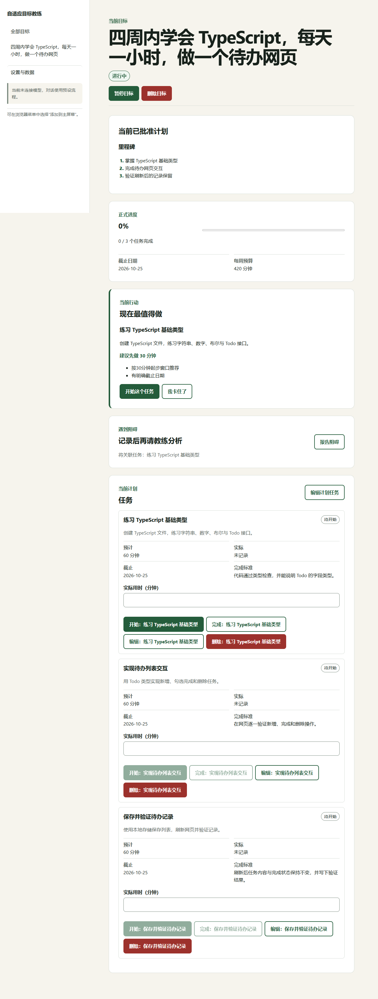

# Goal Coach · 自适应目标教练

把学习和轻工作目标变成可执行、可审阅、有证据的行动计划。

Goal Coach 是一个 **动态 Web 应用 + 可安装 PWA**：Next.js 页面、Node.js 后端、SQLite 数据库与受限 Agent 工具共同工作。DeepSeek 已接入，保留 Qwen 与免费 mock。它不是静态网页，也不会在用户不知情时批准计划或替用户完成实际工作。

## 从这里开始

| 你想做什么 | 阅读入口 |
| --- | --- |
| 10分钟理解功能与范围 | [项目规格与 Agent 设计](docs/specification/project-spec.zh-CN.md) |
| 在自己的电脑运行 | [从零安装与 DeepSeek 配置](docs/guides/quickstart.zh-CN.md) |
| 创建目标、执行、撤销、重排、复盘 | [使用手册](docs/guides/user-guide.zh-CN.md) |
| 看真实模型如何拆解目标 | [两份真实 API 场景案例](docs/examples/README.md) |
| 在阿里云香港部署并邀请朋友 | [Docker 完整上线教程](docs/deployment/aliyun-hong-kong-docker-beginner.zh-CN.md) |
| 查看全部文档和资产 | [文档地图](docs/README.md) · [资产清单](docs/assets/inventory.md) |
| 追溯最初设计与后续决策 | [历史与决策时间线](docs/history/README.md) |

## 主要能力

- 目标契约：成果、验收标准、期限、每周时间与明确假设。
- 3–8项任务草案：行动、完成标准、耗时、依赖、证据类型；用户批准后生效。
- 执行与反馈：当前行动、进展、阻碍、可用时间变更和统一撤销。
- 自适应重规划：生成可比较的草案，保护已完成证据，不靠虚降总估时冒充可行。
- 复盘与数据：保存反思、明确完成、JSON导出、按账号清除业务数据。
- 邀请模式：独立账号、数据隔离、管理员邀请/禁用、模型同意与日配额。
- 手机 PWA：同一后端与账号；离线只显示说明，不缓存私人目标或补发付费请求。

```text
输入目标 → 契约草案 → 人工批准 → 计划草案 → 人工批准
                                      ↓
                         执行 / 证据 / 阻碍 / 撤销
                                      ↓
                  重规划草案与审批 ←→ 复盘 → 明确完成
```

## 快速启动

要求 Node.js **24.20.0**、pnpm **11.19.0**。以下命令在 Windows PowerShell 执行：

```powershell
git clone https://github.com/Royal44-k/Goal-Coach.git
if ($LASTEXITCODE -ne 0) { throw '克隆失败，停止；已有同名目录时不要覆盖' }
Set-Location -LiteralPath './Goal-Coach' -ErrorAction Stop
node --version
pnpm --version
pnpm install --frozen-lockfile
if ($LASTEXITCODE -ne 0) { throw '安装失败，先排错' }
if (-not (Test-Path -LiteralPath .env.local)) {
  Copy-Item -LiteralPath .env.example -Destination .env.local
}
pnpm db:migrate
if ($LASTEXITCODE -ne 0) { throw '迁移失败，先排错' }
pnpm dev
```

打开 [http://127.0.0.1:3000](http://127.0.0.1:3000)。默认mock不收费，也不理解任意自然语言；完整配置、SQLite排错与生产启动见[快速开始](docs/guides/quickstart.zh-CN.md)。不要向聊天或GitHub提交API Key。

## 版本与验证范围

当前应用版本 **0.2.2**，基线验收日期2026-09-27。记录包含1172项代码测试、16项浏览器测试、生产构建、重启/备份/恢复，以及两类真实DeepSeek完整合成流程。公开整理版没有改变应用运行代码。

这些不是“所有情况都成功”的保证：两份真实案例在明确恢复原可用时间后完成；最后容量负例未触发前置条件；模型复盘仍有措辞瑕疵。Linux镜像、香港服务器、HTTPS和实体手机尚未现场验收。有一项已披露的开发工具链中风险公告。[完整验收记录](docs/delivery/full-acceptance-2026-09-27.md) · [安全说明](SECURITY.md)。

<details>
<summary>查看实际界面（mock合成测试截图，不是真实模型案例截图）</summary>



更多：[截图来源和移动布局](docs/examples/README.md)。

</details>

## 项目结构

```text
src/app/           页面与后端HTTP路由
src/components/    目标、任务、教练、账号与PWA界面
src/core/          领域契约、状态机、规划与证据规则
src/server/        Agent、权限、服务、仓储、SQLite与模型适配
drizzle/           数据库迁移
evals/             免费与显式付费评测
e2e*/              隔离浏览器测试
deploy/            Caddy和服务器环境示例
docs/              当前规格、教程、案例、验收和历史设计
```

本版没有支付、开放注册、团队协同、联网搜索、RAG、后台自动执行或原生Flutter安装包。GitHub源码公开不等于网站已经上线；朋友使用前完成部署教程的云端验收清单。

## 权利与贡献边界

仓库暂未授予开源许可证；公开可见不代表自动授权任意商业再分发。项目依赖遵循各自许可证，详见[权利说明](NOTICE.md)。不要在Issue提交秘密、数据库或未脱敏用户目标；安全问题处理见[SECURITY.md](SECURITY.md)。
