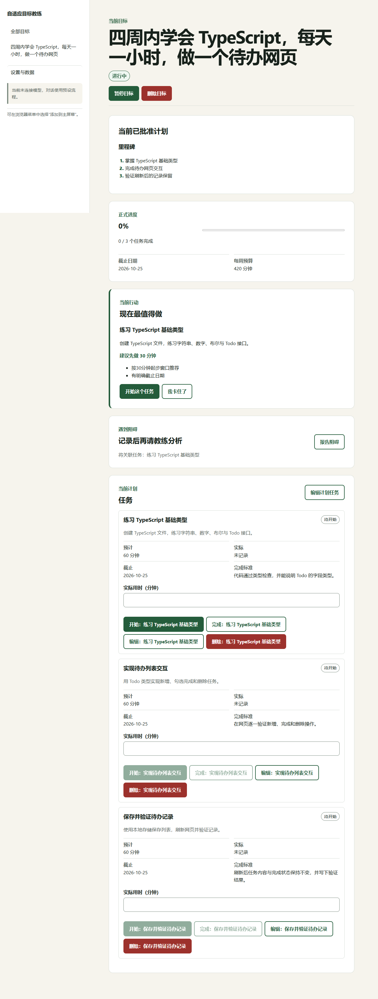

# 场景演示与证据

这组案例演示产品适用的真实生活场景，但**不是客户案例或真人成果证明**。两条完整链路确实调用过 DeepSeek；输入目标、完成证据和操作人员均为验收用合成数据。界面图片则来自独立的 mock 浏览器测试，不能拿来证明模型回答质量。

| 场景 | 目标与困难 | 已留存证据 |
| --- | --- | --- |
| [学习：完成 TypeScript 待办网页](learning.md) | 从学习计划进入执行，遇到页面骨架阻碍，重新拆小步骤 | 7 次真实 API 请求；结构化计划、重排和流程断言 |
| [轻工作：整理会议决议与待办目录](light-work.md) | 建立可检索目录，遇到提取困难，先完成一条再扩展 | 7 次真实 API 请求；结构化计划、重排和流程断言 |

复现前先按[本地启动指南](../guides/quickstart.zh-CN.md)运行，再按[使用教程](../guides/user-guide.zh-CN.md)操作。用自己的目标时，必须诚实填写时间和完成证据，不照抄演示中的完成记录。运行真实模型会收费；结果受模型随机性、日期和可用容量影响，不承诺原样再现。

## 界面图集：实际页面，mock 数据

这些不是设计稿，而是 2026-09-27 自动浏览器验收的页面截图。截图与上述真实 API 案例并非同一次运行。移动图是桌面浏览器的 375 像素窄视口，**不是手机真机验收**。截图来源和文件校验值见[来源记录](../assets/screenshot-provenance.json)。

| 画面 | 查看 |
| --- | --- |
| 工作区：目标、计划、执行状态 | [桌面截图](images/workspace-desktop.mock.png) |
| 执行：任务状态和证据操作 | [窄屏截图](images/execution-mobile.mock.png) |
| 重排：审阅变更再确认 | [草案截图](images/replan-review.mock.png) |

展开桌面工作区截图（较长）

## 如何解读证据

- `evidence/*.json` 是真实调用产物的**脱敏结构化摘录**，保留目标契约、任务、容量、断言与请求用量；随机标识改为序号，不包含原始内部推理、完整私人日志或密钥。
- `passed: true` 是验收器的结构断言通过，不等于建议完美、用户真的完成成果、已有商业收益或所有安全边界通过。
- 两个成功场景都在用户**明确恢复原每周可用时间**后重排，不是“时间减半也无损完成”。
- 报告保留失败与未覆盖项，见[全量验收记录](../delivery/full-acceptance-2026-09-27.md)。未采用反复重试直到只保留成功样本的呈现方式。
